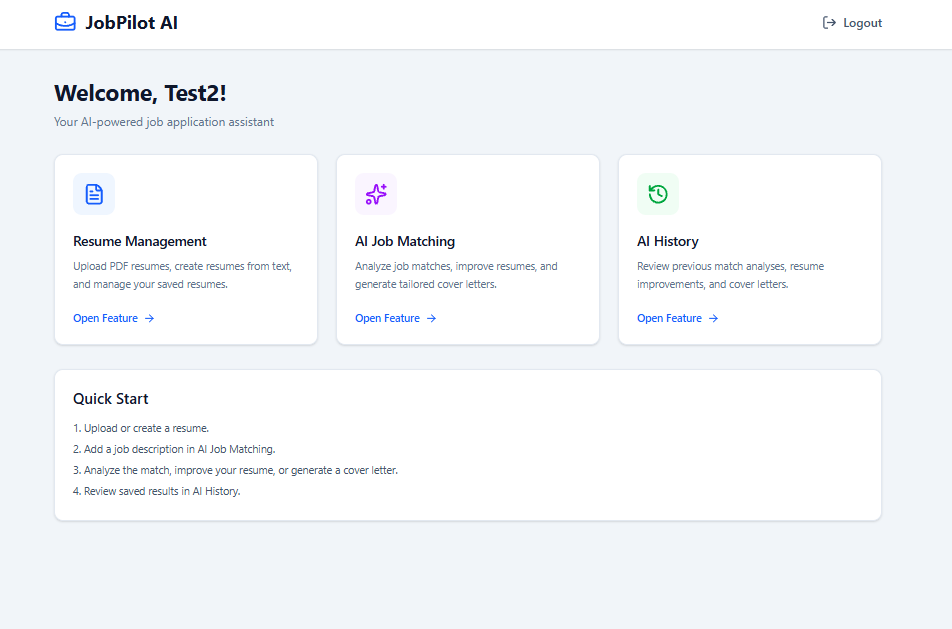
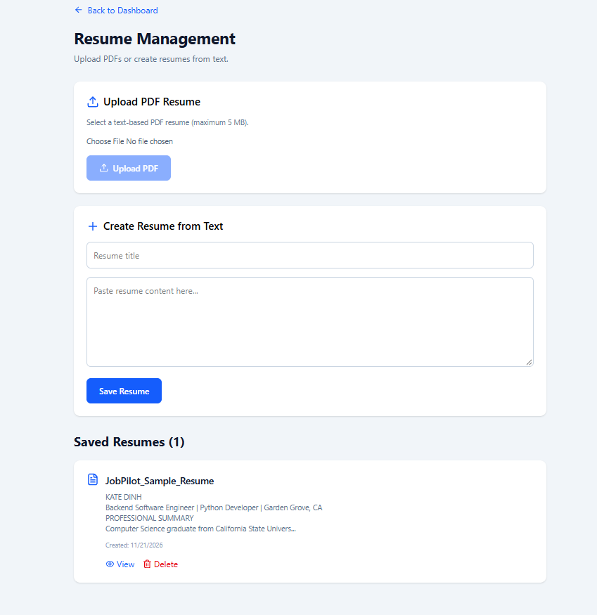
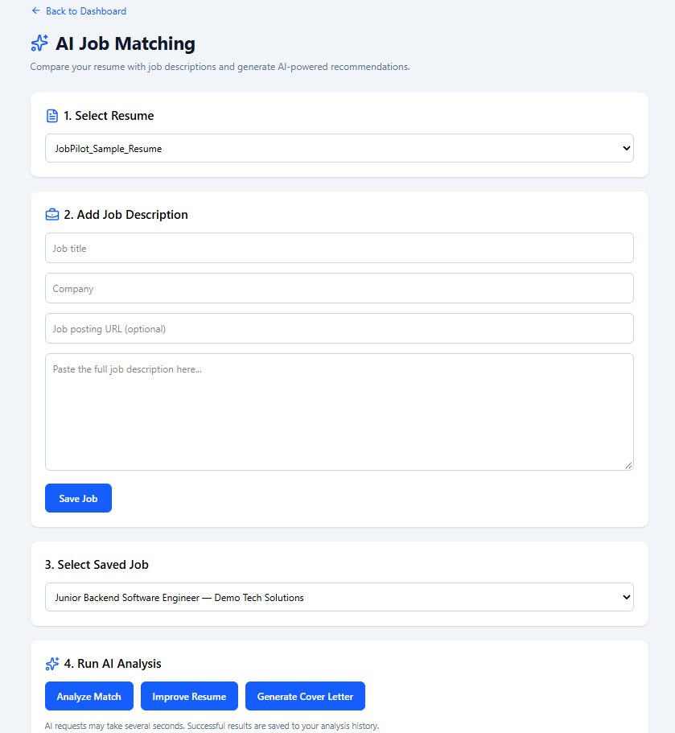
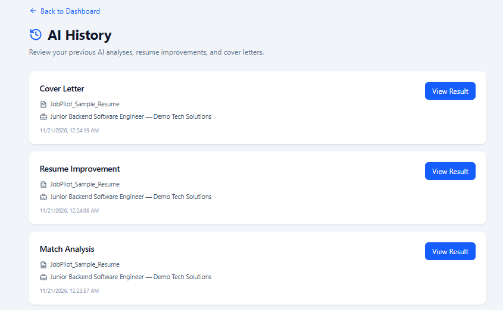

# JobPilot AI

An AI-powered job application assistant that helps users manage resumes, analyze job matches, improve resumes, and generate tailored cover letters.

Built with React, Node.js, Express, MongoDB, and the OpenAI API.

## Application Screenshots

### Dashboard


### Resume Management


### AI Job Matching


### AI History


## Features

### Authentication
- User registration and login
- JWT-based authentication
- Protected API endpoints and frontend routes

### Resume Management
- Create resumes from text
- Upload PDF resumes (up to 5 MB)
- Extract text from PDF files
- View and delete saved resumes
- Store resume content in MongoDB

### AI Job Matching
- Save job descriptions
- Select a resume and saved job
- Analyze resume-to-job compatibility
- Generate resume improvement suggestions
- Generate tailored cover letters
- Display AI results in a readable format

### AI History
- Save successful AI analyses
- Review previous match analyses
- Review resume improvements and cover letters
- Copy generated results

## Tech Stack

**Frontend**
- React 19
- Vite
- Tailwind CSS
- React Router
- Axios
- Lucide React

**Backend**
- Node.js
- Express 5
- MongoDB
- Mongoose
- JWT authentication
- OpenAI API
- Multer
- pdf-parse

## Architecture

```text
React + Vite
     |
     | HTTP / REST API
     v
Node.js + Express
     |
     +-- JWT Authentication
     |
     +-- Resume Management
     |       |
     |       +-- PDF Text Extraction
     |
     +-- Job Management
     |
     +-- AI Services
     |       |
     |       +-- OpenAI API
     |
     v
MongoDB Atlas
```

## API Endpoints

### Authentication

| Method | Endpoint | Description |
|---|---|---|
| POST | `/api/auth/register` | Register a user |
| POST | `/api/auth/login` | Log in |
| GET | `/api/auth/me` | Get authenticated user |

### Resumes

| Method | Endpoint | Description |
|---|---|---|
| POST | `/api/resumes` | Create a text resume |
| POST | `/api/resumes/upload` | Upload a PDF resume |
| GET | `/api/resumes` | Get saved resumes |
| GET | `/api/resumes/:id` | Get a resume |
| DELETE | `/api/resumes/:id` | Delete a resume |

### Jobs

| Method | Endpoint | Description |
|---|---|---|
| POST | `/api/jobs` | Create a job |
| GET | `/api/jobs` | Get saved jobs |
| GET | `/api/jobs/:id` | Get a job |
| PUT | `/api/jobs/:id` | Update a job |
| DELETE | `/api/jobs/:id` | Delete a job |

### AI

| Method | Endpoint | Description |
|---|---|---|
| POST | `/api/ai/analyze-match` | Analyze resume-job match |
| POST | `/api/ai/improve-resume` | Generate resume improvements |
| POST | `/api/ai/generate-cover-letter` | Generate a cover letter |
| GET | `/api/ai/history` | Get saved AI results |

AI endpoints require authentication and accept a `resumeId` and `jobId`.

## Local Setup

### Prerequisites

- Node.js and npm
- MongoDB database
- OpenAI API key

### 1. Clone the repository

```bash
git clone https://github.com/tpdinh10/jobpilot-ai.git
cd jobpilot-ai
```

### 2. Install backend dependencies

```bash
npm install
```

### 3. Configure environment variables

Create a `.env` file in the project root:

```env
PORT=5000
MONGO_URI=your_mongodb_connection_string
JWT_SECRET=your_secure_jwt_secret
JWT_EXPIRES_IN=7d
OPENAI_API_KEY=your_openai_api_key
```

### 4. Start the backend

```bash
npm run dev
```

The backend runs on port 5000 with the current local configuration.

### 5. Install frontend dependencies

Open a second terminal:

```bash
cd frontend
npm install
npm run dev
```

Open:

http://localhost:5173

## Usage

1. Register or log in.
2. Upload a PDF resume or create a text resume.
3. Open AI Job Matching.
4. Save a job description.
5. Select the resume and job.
6. Run Match Analysis, Improve Resume, or Generate Cover Letter.
7. Review previous results in AI History.

## Security

- JWT authentication for protected endpoints
- User-specific resume, job, and AI history records
- PDF upload size and file-type restrictions
- Environment variables excluded from Git

## Current Limitations

- PDF extraction works best with text-based PDFs; scanned PDFs may require OCR.
- AI-generated content should be reviewed for accuracy before use.
- AI requests require a configured OpenAI API key and may incur API usage charges.
- The original uploaded PDF is not stored; extracted text is saved instead.

## Future Improvements

- Job application status tracking interface
- Search and filters for saved jobs
- Export AI-generated documents
- Automated testing and deployment improvements

## Author

Kate Dinh

Computer Science Graduate — California State University, Long Beach

GitHub: https://github.com/tpdinh10
```
